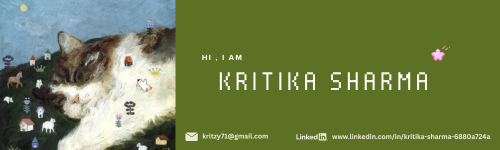

  

  <a href="mailto:kritzy71@gmail.com">✉ EMAIL</a>
  &nbsp; · &nbsp;
  <a href="https://www.linkedin.com/in/kritika-sharma-6880a724a/">LINKEDIN ↗</a>

## 🌿 `whoami` — a little about me

Hello! I'm **Kritika Sharma**, a Computer Engineering student exploring the world of software, AI, and  technology.

Think of this page as my little digital garden: a place where I grow my skills, experiment with ideas, and share the things I build.

- 🌱 Currently learning web development, Python, and SQL
- 🍄 Interested in AI, cybersecurity , and creative technology
- 🪴 Building projects to turn ideas into working applications

---

## 🌷 `the greenhouse` — my tech stack

---

## 🍄 `little things I'm building`

### 🪴 ResolveIQ
An AI-assisted customer support platform for small businesses.

### 🌾 Krishi Samadhaanam
An agricultural support concept focused on helping farmers access useful guidance.

[Explore my repositories →](https://github.com/YOUR_USERNAME?tab=repositories)

---

## 🌱 `the growth journal`

---

*little by little, effort continues.*

